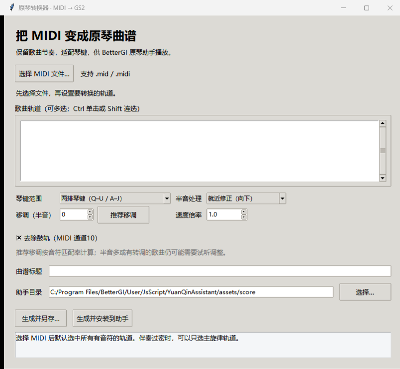

# 原琴转换器 · MIDI → GS2

把普通 MIDI 文件转换成《原神》**原琴助手（BetterGI / YuanQinAssistant）** 能直接播放的 `.gs2` 曲谱。

保留原曲节奏与时间轴，自动移调到 C 大调、把超出琴域的音符按八度折回，输出带自校验的曲谱文件：生成后无法在游戏里弹错，因为转换阶段就会拦下不合法的按键序列。



## 特性

- **保留原速度**：读取 MIDI 的 tempo map，按 tick 精确还原节奏，可选 0.25–4 倍速缩放
- **多轨选择**：默认选中所有有音符的轨道，伴奏过密时可以只留主旋律
- **自动移调**：统计各半音下"落在 C 大调白键上"的音符比例，在 −6 ~ +5 内推荐最佳移调量
- **半音三种处理**：就近向下修正 / 向上修正 / 直接忽略
- **音域折回**：超出琴键范围的音符按八度回折，不丢音、不越界
- **两排 / 三排**：两排琴键（60–83，A–J + Q–U）与三排诗琴（48–83，加 Z–M）
- **鼓轨过滤**：默认剔除 MIDI 通道 10
- **同名不覆盖**：目标文件已存在时自动加 `（2）` `（3）` 后缀
- **生成即校验**：`validate()` 逐条检查事件格式、按键配对、未松开琴键、音域与白键合法性，不合法直接拒绝写出
- **一键安装**：可直接写入 BetterGI 的 `assets/score` 目录，也可另存到任意位置

## 快速开始

### 方式一：直接运行 exe

双击 `原琴转换器.exe`（如发布页提供），无需安装 Python、无需联网。

### 方式二：源码运行

```powershell
python -m pip install -r requirements.txt
python app.py
```

需要 Python 3.9+（自带 tkinter）与 [`mido`](https://github.com/mido/mido)。

## 使用步骤

1. 点击 **选择 MIDI 文件**，打开 `.mid` / `.midi`
2. 选择要保留的轨道（Ctrl 单击多选、Shift 连选）
3. 选择 **琴键范围**：两排为默认，三排诗琴多出低音区
4. 点 **推荐移调**，或手动填半音数；速度倍率 1 表示原速
5. 按需调整 **半音处理** 与 **去除鼓轨**
6. 点 **生成并安装到助手**，或 **生成并另存**
7. 停止并重新运行原琴助手，进入游戏演奏界面，搜索曲谱标题播放

默认助手目录：

```
C:/Program Files/BetterGI/User/JsScript/YuanQinAssistant/assets/score
```

BetterGI 装在别处时，用 **选择…** 定位到对应的 `assets/score`。目录无写入权限时会提示改用"另存 + 手动复制"。

## 键位映射

原琴只能弹 C 大调自然音，三排共 36 键：

| 音域 | MIDI | 键位 |
|---|---|---|
| 低音区（仅三排） | 48 50 52 53 55 57 59 | `Z X C V B N M` |
| 中音区 | 60 62 64 65 67 69 71 | `A S D F G H J` |
| 高音区 | 72 74 76 77 79 81 83 | `Q W E R T Y U` |

例：MIDI `72/74/76` → `Q/W/E`，`60/62/64` → `A/S/D`，`48/50/52` → `Z/X/C`。

## GS2 文件格式

```
!v/2
!gi/0
!ti/兰亭序（两排琴键版）
!ar/原琴转换器
!di/480
移调-2半音；速度1倍；超出音域按八度折回。
!tr/0s789473|1200n67|238u67|2n69|238u69|...
```

`!tr` 里以 `|` 分隔事件，每个事件为「经过的 tick 数 + 类型 + 值」：

- `n` 按下音符（值为 MIDI 音高）
- `u` 松开音符
- `s` 设置速度（微秒 / 四分音符）

`!di` 是 MIDI 的 ticks per beat，播放器用它把 tick 换算成毫秒。

## 转换原理

1. `mido` 读入 MIDI，按轨道累加 tick，把 `note_on` / `note_off` 配对成「音高 + 起止时间」；未闭合的音符在轨末补结束事件并记录警告
2. 按轨道与通道筛选，默认去掉鼓轨（channel 10）
3. 统计全曲音符分布，算出在 C 大调白键上命中率最高的移调量
4. 残余半音按所选策略修正，越界音符按八度折回，同刻同键合并、重叠事件截断
5. 生成 `!v/2` 曲谱文本，`validate()` 自检通过后写入磁盘

## 已知限制

- 支持 MIDI Type 0 / 1；不支持异步 Type 2 与 SMPTE 时间格式
- 只吃 MIDI，不能把 MP3、视频或简谱图片直接转成曲谱
- "推荐移调"基于自然音命中率，不等于自动识别全部转调；转调多或半音多的曲子仍需试听微调
- 半音修正与八度折回会改变部分旋律、和声或层次
- 延音踏板、音量、弯音、音色等控制信息不输出，实际延音由游戏乐器决定
- 曲谱长度跟随输入文件，不会补足原曲缺失段落
- 钢琴编配通常最适合原琴；多乐器 MIDI 建议先试主旋律 + 少量伴奏

## 测试

```powershell
python -m unittest discover -s tests -v
```

测试不依赖外部 MIDI 文件：用 `mido` 现场构造样例，覆盖轨道读取、时长换算、移调推荐、半音三种策略、鼓轨过滤、八度折回、空选择报错、同名避让与文件名净化。

## 打包

```powershell
python -m pip install pyinstaller
pyinstaller --noconfirm --onefile --windowed --name 原琴转换器 app.py
```

产物在 `dist/原琴转换器.exe`。

## 关于第三方

- [BetterGI](https://github.com/babalae/better-genshin-impact) 及其原琴助手（YuanQinAssistant）由第三方开发，本项目仅生成与之兼容的曲谱文件，与官方无关联
- 依赖 [`mido`](https://github.com/mido/mido)（MIT）

本仓库**不包含**任何 MIDI 源文件或转换后的曲谱成品，避免传播可能受版权保护的音乐内容。请自行准备拥有合法使用权的 MIDI。

## License

[MIT](LICENSE)
